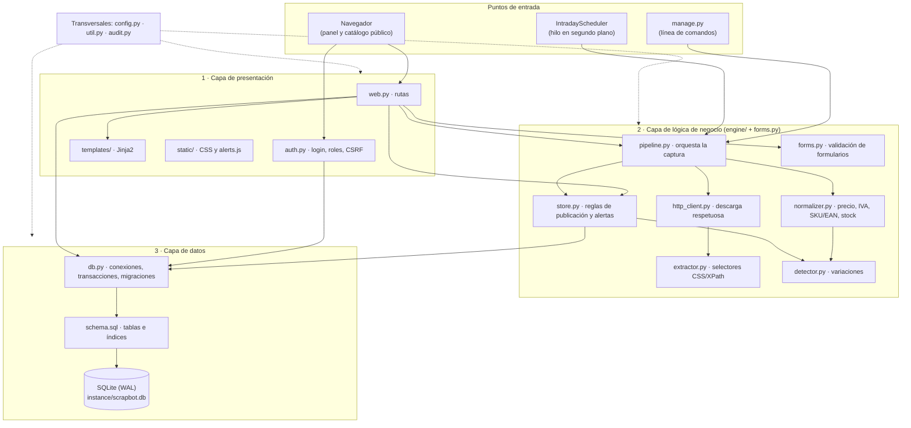
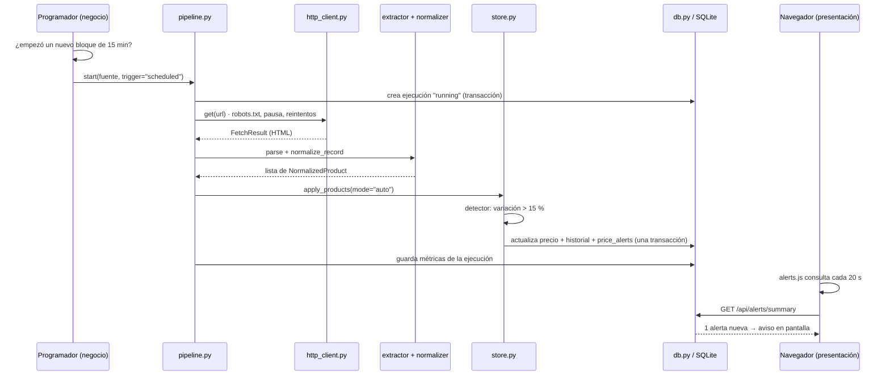

# ScrapBot · Arquitectura en capas

Este documento explica en profundidad cómo está organizado ScrapBot según el **modelo de capas**: qué hace cada capa, qué módulos la componen, cómo se comunican, qué datos cruzan cada frontera y dónde la separación todavía no es perfecta. Todo lo descrito corresponde al código del repositorio.

## 1. Qué es el modelo de capas y por qué se usa aquí

Una arquitectura en capas divide un sistema en niveles horizontales. Cada nivel tiene una responsabilidad única y **solo conoce al nivel inmediatamente inferior**. Una solicitud entra por arriba, baja capa por capa hasta los datos y la respuesta sube por el mismo camino.

Las reglas que se buscan cumplir son tres:

| Principio | Qué significa | Cómo se nota en ScrapBot |
| --- | --- | --- |
| **Separación de responsabilidades** | Cada capa resuelve un tipo de problema. | Las plantillas no calculan IVA; el normalizador no sabe que existe Flask. |
| **Dependencia hacia abajo** | Una capa usa la de abajo, nunca la de arriba. | `engine/` no importa nada de `web.py` ni de `templates/`. |
| **Contratos explícitos** | Entre capas viajan estructuras de datos definidas, no detalles internos. | El motor devuelve objetos `NormalizedProduct` y `ApplyResult`, no HTML ni filas sueltas. |

Para un proyecto como este, la ventaja práctica es que se puede cambiar una capa sin romper las demás: rediseñar el panel no toca el motor de extracción, y agregar una tienda nueva solo requiere configurar selectores en la base de datos.

ScrapBot es **una sola aplicación Flask** con tres capas lógicas. No son tres servidores: son tres grupos de módulos con responsabilidades separadas, que corren en el mismo proceso.

## 2. Vista general

La flecha de `web.py` a `db.py` es la excepción que se explica en la sección 7.

## 3. Capa 1 · Presentación

**Responsabilidad:** recibir las solicitudes del usuario, verificar quién es y qué puede hacer, pedirle a la capa de negocio que actúe y mostrar el resultado. No contiene reglas de negocio: no decide si un precio es anómalo ni cómo se calcula el IVA.

| Módulo | Qué hace |
| --- | --- |
| `scrapbot/__init__.py` | Crea la aplicación (`create_app`), abre una conexión por solicitud, registra filtros de plantilla (`clp`, `dt`), cabeceras de seguridad (CSP, `X-Frame-Options`) y arranca el programador. |
| `scrapbot/auth.py` | Login con selector **Usuario / Administrador**, bloqueo tras 5 intentos fallidos, expiración por inactividad (15 min), protección CSRF en todo `POST`, decoradores `login_required` y `admin_required`. |
| `scrapbot/web.py` | Rutas del panel: fuentes, productos, edición de precio y stock, alertas, ejecuciones, auditoría, exportaciones CSV, usuarios y parámetros. También el catálogo público. |
| `scrapbot/templates/` | Vistas HTML (Jinja2 con escape automático, lo que evita inyección de HTML). |
| `scrapbot/static/` | Estilos y `alerts.js`, que consulta `/api/alerts/summary` cada 20 s y muestra un aviso cuando el bot genera una alerta. |

### Control de acceso en esta capa

El rol de la cuenta (`admin` o `analyst`) se guarda en la base de datos. En el login, la persona elige además el **tipo de acceso**:

- Una cuenta `analyst` que elige «Administrador» es rechazada con el mensaje «Esta cuenta no tiene permisos de administrador».
- Una cuenta `admin` que elige «Usuario» entra con permisos de usuario: puede consultar, pero no editar precios ni configurar.
- Solo `admin` + acceso «Administrador» activa `g.is_admin`, que es lo que exigen `admin_required` y las plantillas para mostrar la edición.

Así el permiso queda decidido en un único lugar (`auth.py`) y el resto de la capa solo pregunta `g.is_admin`.

## 4. Capa 2 · Lógica de negocio

**Responsabilidad:** las reglas del dominio. Cómo se descarga una tienda sin sobrecargarla, cómo se interpreta un precio chileno, cuándo una variación es anómala, qué se publica y qué se alerta. Esta capa **no sabe que existe una web**: la misma función la llaman el panel, la línea de comandos y el programador.

### 4.1 Módulos y su papel

| Módulo | Responsabilidad | Entrada → salida |
| --- | --- | --- |
| `engine/pipeline.py` · `SyncRunner` | Orquesta una ejecución completa y registra su resultado. Impide dos capturas simultáneas de la misma fuente. | id de fuente → id de ejecución |
| `engine/http_client.py` · `PoliteHttpClient` | Descarga respetando `robots.txt`, con pausa aleatoria entre solicitudes, timeout, reintentos con espera exponencial y límite de tamaño. No sigue redirecciones a otros dominios. | URL → `FetchResult` (HTML, estado, hash SHA-256) |
| `engine/extractor.py` · `PageParser` | Aplica los selectores CSS o XPath configurados para la fuente y encuentra la página siguiente. | HTML + `RuleSet` → `PageResult` con `ParsedItem` |
| `engine/normalizer.py` | Convierte textos en datos válidos: `"$12.990"` → `12990`; valida SKU y el dígito verificador del EAN; interpreta stock (`"Agotado"`, `"Quedan 3"`); desglosa o recarga el IVA. | `ParsedItem.values` → `NormalizedProduct` o `InvalidRecord` |
| `engine/detector.py` | Decide si un cambio de precio es menor o anómalo comparando con el umbral. | precio publicado + nuevo → `Decision` |
| `engine/store.py` | Aplica las reglas de publicación: crea o actualiza productos, registra historial, genera **alertas automáticas** (cambio brusco o acumulado), respeta precios fijados por un administrador y marca productos retirados. También la edición manual de precio y stock. | lista de `NormalizedProduct` → `ApplyResult` |
| `engine/scheduler.py` · `IntradayScheduler` | Dispara capturas automáticas cada N minutos o en horarios fijos, sin duplicar disparos aunque haya varios procesos. | reloj → llamadas a `SyncRunner.start` |
| `forms.py` | Valida formularios de fuentes y parámetros (URLs, selectores con sintaxis correcta, rangos). | formulario → (datos limpios, errores) |

### 4.2 Reglas de negocio principales

- **Publicación automática con alerta** (modo por defecto). Todo precio capturado se publica al instante. Si la variación supera el umbral (15 % por defecto) respecto del precio publicado, se registra una alerta de tipo *cambio brusco*.
- **Variación acumulada.** Si varias subidas o bajadas pequeñas suman más que el umbral dentro de la ventana configurada (7 días por defecto), se registra una alerta *acumulada*. Después de cada alerta o edición manual, la comparación se reinicia para no repetir alertas.
- **Modo de revisión (opcional).** Desde Parámetros se puede volver al comportamiento original: la variación queda retenida hasta que alguien la apruebe o rechace con una justificación.
- **Precio fijado manualmente.** Si un administrador edita un precio y marca «mantener», el bot sigue confirmando que el producto existe, pero no sobrescribe precio ni stock hasta que se libere.
- **Productos retirados.** Si una captura recorre todas las páginas sin errores y un producto ya no aparece, se marca como retirado y deja de mostrarse en el catálogo público. Si la captura fue incompleta, no se retira nada.
- **Recalcular IVA.** Si cambia la tasa de IVA, el neto y el IVA se recalculan aunque el precio final de la tienda sea el mismo.

### 4.3 Objetos que cruzan las fronteras

Estos son los «contratos» de la capa. Son clases de datos simples (`dataclass`), sin lógica de presentación ni SQL:

| Objeto | Definido en | Contenido |
| --- | --- | --- |
| `RuleSet` | `extractor.py` | Selectores vigentes de una fuente, páginas máximas, si el precio incluye IVA. |
| `FetchResult` | `http_client.py` | URL final, estado HTTP, HTML, hash, milisegundos, intentos. |
| `ParsedItem` / `PageResult` | `extractor.py` | Textos crudos de cada producto y la URL de la página siguiente. |
| `NormalizedProduct` | `normalizer.py` | SKU, EAN, nombre, neto, IVA, precio final, stock, disponibilidad, advertencias. |
| `Decision` | `detector.py` | Acción (`unchanged` / `apply` / `freeze`) y porcentaje de variación. |
| `ApplyResult` | `store.py` | Conteo de creados, actualizados, sin cambios, alertados, fijados y productos vistos. |
| `RunStats` | `pipeline.py` | Métricas de la ejecución que se guardan en la tabla `runs`. |

## 5. Capa 3 · Datos

**Responsabilidad:** guardar y recuperar información de forma segura y consistente. No interpreta los datos: no sabe qué es una alerta ni un precio anómalo.

| Módulo | Qué hace |
| --- | --- |
| `scrapbot/db.py` | Abre conexiones SQLite en modo **WAL** con `synchronous=FULL` (resistente a cortes de energía), activa claves foráneas, ofrece `transaction()` (todo o nada: `COMMIT` o `ROLLBACK`), lee y escribe parámetros, y **migra** bases creadas con versiones anteriores agregando las columnas nuevas sin perder datos. |
| `scrapbot/schema.sql` | Define tablas, restricciones (`CHECK`, `UNIQUE`) e índices. |
| `instance/scrapbot.db` | El archivo de base de datos (no se versiona en Git). |

### Tablas agrupadas por responsabilidad

| Grupo | Tablas | Para qué |
| --- | --- | --- |
| Seguridad | `users`, `login_log` | Cuentas con contraseña en hash PBKDF2 y registro de cada intento de acceso. |
| Configuración | `settings`, `sources`, `source_rules` | Parámetros de negocio y fuentes con sus selectores. Las reglas se versionan: cada cambio crea una versión nueva. |
| Catálogo | `products`, `price_history` | Estado actual de cada producto y todos sus cambios (del bot o manuales, con usuario y motivo). |
| Alertas | `price_alerts`, `discrepancies` | Alertas automáticas y, en modo revisión, variaciones retenidas. |
| Trazabilidad | `runs`, `http_log`, `parse_errors`, `audit_log` | Cada ejecución, cada solicitud HTTP, cada error de extracción y cada acción de una persona. |

La integridad también se protege en esta capa: un producto debe tener SKU o EAN (`CHECK`), no puede haber dos productos con el mismo SKU en una fuente (`UNIQUE`), y solo puede existir una revisión pendiente por producto (índice único parcial).

## 6. Recorridos completos por las capas

### 6.1 Captura automática con alerta (sin intervención humana)

Si algo falla al escribir, la transacción se revierte completa: nunca queda un catálogo a medio actualizar.

### 6.2 Edición manual de precio por un administrador

1. **Presentación.** `POST /products/<id>/edit` llega a `web.py`. `admin_required` comprueba `g.is_admin` (rol admin y acceso «Administrador»); si no, responde 403. Se valida el formulario: precio legible, stock entero, motivo de al menos 5 caracteres.
2. **Negocio.** `store.edit_product` recalcula neto e IVA con la tasa vigente, decide si el producto queda fijado frente al bot y cierra cualquier revisión pendiente.
3. **Datos.** En una sola transacción: actualiza `products`, agrega una fila en `price_history` con `changed_by` y `note`, y registra `product.edit` en `audit_log`.
4. **Presentación.** Redirige al detalle del producto con un mensaje de confirmación.

### 6.3 Exportación de la auditoría de cambios de precio

1. **Presentación.** `GET /export/price-changes.csv?desde=…&hasta=…` valida las fechas (hora de Chile) y las convierte a UTC.
2. **Datos.** Una consulta con la función de ventana `LAG` obtiene, para cada cambio, el precio anterior del mismo producto, y lo une con la alerta o la aprobación asociada.
3. **Presentación.** Arma un CSV con separador `;` y BOM (abre directo en Excel con configuración regional de Chile), neutraliza fórmulas maliciosas y registra la exportación en la bitácora.

### 6.4 Catálogo público

`GET /catalogo` no requiere sesión. `web.py` filtra fuentes activas y productos no retirados, aplica búsqueda y orden, y renderiza `public_catalog.html`. Los valores de búsqueda se pasan como parámetros SQL (`?`), nunca concatenados, lo que impide inyección SQL.

## 7. Dónde la separación no es perfecta (y cómo se mejoraría)

Un modelo de capas estricto pide que la presentación nunca hable directamente con los datos. En ScrapBot hay dos concesiones conscientes:

1. **`web.py` hace consultas SQL de lectura directamente** (listados, conteos, filtros, exportaciones). Para un prototipo esto reduce código, porque cada pantalla necesita una consulta distinta y ya existe una conexión por solicitud. Las **escrituras importantes** sí pasan por la capa de negocio: publicar precios, editar productos, resolver revisiones y marcar alertas.
2. **`store.py` mezcla reglas de negocio con SQL.** Decide qué publicar y alertar, y también escribe las filas. Funciona como frontera entre negocio y datos.

La mejora natural sería agregar dos piezas:

- Una **capa de servicios** (por ejemplo `services/catalog.py`) con funciones como `listar_productos(filtros)` o `exportar_cambios(desde, hasta)`, para que `web.py` solo traduzca HTTP a llamadas y resultados a HTML.
- **Repositorios** (por ejemplo `repositories/products.py`) que concentren el SQL. `store.py` quedaría solo con las reglas y pediría al repositorio guardar los cambios.

Con eso, cambiar SQLite por PostgreSQL afectaría únicamente a los repositorios y a `db.py`.

## 8. Cómo las pruebas reflejan las capas

La suite (128 pruebas) está organizada de forma que cada capa se pueda probar por separado:

| Capa | Archivo de pruebas | Qué verifica |
| --- | --- | --- |
| Negocio (unidades) | `test_normalizer.py`, `test_extractor.py`, `test_http_client.py`, `test_scheduler.py` | Reglas aisladas, sin web ni base de datos real cuando no hace falta. |
| Negocio + datos | `test_store.py`, `test_pipeline.py` | Publicación, alertas, historial y transacciones sobre una base temporal y un sitio web falso local. |
| Presentación | `test_web.py` | Login, permisos, CSRF, rutas y exportaciones a través del cliente de pruebas de Flask. |
| Sistema completo | `test_acceptance.py` | Lote de 100 productos de punta a punta, con capturas repetidas. |
| Entrega 50 % | `test_correcciones.py` | Los 5 bugs corregidos. |
| Entrega 80-100 % | `test_entrega.py` | Funcionalidades nuevas, cruzando las tres capas. |

Que la capa de negocio se pueda probar sin levantar el panel es la evidencia práctica de que la separación funciona.

## 9. Seguridad distribuida por capa

| Capa | Medidas |
| --- | --- |
| Presentación | Sesión con expiración por inactividad, CSRF en todo `POST`, CSP sin scripts externos, escape automático de HTML, CSV sin fórmulas ejecutables, redirecciones solo dentro del sitio. |
| Negocio | Respeto de `robots.txt`, identificación del bot, pausas y límites, rechazo de redirecciones a otros dominios, validación estricta de datos capturados. |
| Datos | Contraseñas en PBKDF2-SHA256 (600.000 iteraciones), consultas parametrizadas, restricciones de integridad, transacciones atómicas, bitácora de auditoría. |

## 10. Procesos en ejecución

Con `python manage.py serve` corre **un proceso** con:

- el servidor web (waitress si está instalado; si no, el servidor de desarrollo de Flask);
- un **hilo** del programador que revisa el reloj cada 20 segundos;
- hilos temporales para las capturas lanzadas con «Ejecutar ahora».

La tienda de demostración (`python -m demo_site.app`) es un proceso aparte que simula sitios externos. Si se despliegan varios procesos web, el programador usa una reserva atómica en la base de datos para que cada horario se dispare una sola vez.
